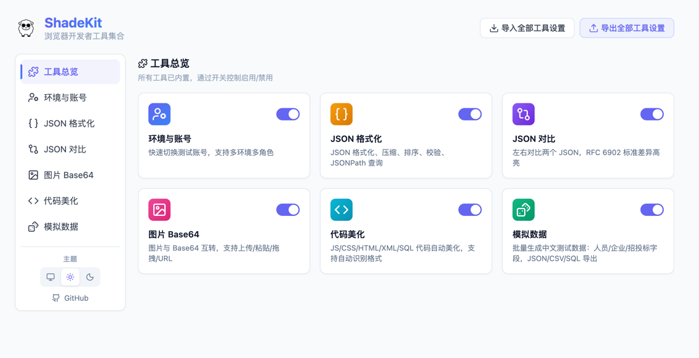

# ShadeKit

[简体中文](README.md) | **English**

[](https://github.com/shadesheep/shadekit/actions/workflows/ci.yml)
[](LICENSE)

A browser toolbox for development, testing, and delivery: **one-click switching across multiple environments and accounts**, plus everyday utilities for JSON, code formatting, mock data, and more. Account configurations are stored in your local browser, and the core tools run entirely locally, including on offline intranets.



*Tools overview: all tools are built in and can be enabled or disabled individually.*

## What Problems Does It Solve?


*Illustration: switching back and forth between test, staging, and production environments and multiple accounts.*

- **Repeated logins across multiple environments and accounts** — Local, test, and staging environments each have multiple role-based accounts, and every switch requires manually logging out, finding credentials, and logging back in. ShadeKit automates the entire **logout → login → redirect** flow. With **Universal Login**, you can visually select the username field, password field, and login button to support common form-based login systems without changing the target application's code.
- **Uncertainty about the current environment** — A persistent, translucent environment indicator in a page corner helps prevent production operations from being performed by mistake in what you thought was a test environment.
- **Concerns about pasting internal data into online tools** — JSON formatting and comparison, code beautification, and mock data generation all run locally in your browser. No data is sent to any server, and the tools continue to work offline or on an intranet.
- **Ad hoc business test data** — Generate Chinese names, national ID numbers, phone numbers, companies, bidding and tendering data, and other fields in bulk, then export them as JSON, CSV, or SQL with one click.

## Features

| Tool | Description | How to open |
|------|-------------|-------------|
| Environments & Accounts | One-click switching across multiple environments and accounts, with automatic logout → login → redirect; Universal Login supports custom integration with common form-based systems | Floating panel / Popup / `Alt+Shift+A` |
| Environment Indicator | A persistent, translucent label in a page corner identifies the current environment (local/test/production); all four corner positions are configurable | Automatically injected |
| JSON Page Formatting | Automatically renders a collapsible tree when a JSON API URL is opened directly in the browser | Automatically injected |
| JSON Formatter | Format, minify, sort, and validate JSON; run JSONPath queries and parse nested escaped JSON | Standalone tab |
| JSON Diff | Compare two JSON documents side by side, with differences highlighted according to RFC 6902 | Standalone tab |
| Image Base64 | Convert between images and Base64; supports upload, paste, drag and drop, and URLs | Standalone tab |
| Code Beautifier | Beautify JS/CSS/HTML/XML/SQL with automatic format detection | Standalone tab |
| Mock Data | Generate Chinese test data in bulk (people/companies/bidding and tendering), with JSON/CSV/SQL export | Standalone tab |

## Installation

- [Chrome Web Store](https://chromewebstore.google.com/detail/mpjleclhdlfhdcimphbcbcikklhgkimm)
- [Microsoft Edge Add-ons](https://microsoftedge.microsoft.com/addons/detail/devtools/lgoakbbkpmkpcpmkkcmolgommccofkgn)
- [Firefox Add-ons](https://addons.mozilla.org/zh-CN/firefox/addon/shadekit/)

You can also build from source and load the extension manually (see “Quick Start” below).

## Usage

### Environments & Accounts

Open the floating panel on a web page, select an environment and then an account, and confirm to switch with one click. Login is automatic, and the current environment remains visible.


*Illustration: select an environment, then an account, and confirm to switch with one click.*


*The actual ShadeKit interface with a fictional local demo system; all accounts and business data are examples.*

#### Initial Setup: 3 Steps

1. **Create an environment**: Right-click the extension icon → **Options** → **Environments & Accounts** → **New Environment**, then enter the environment URL. The name and label are filled in automatically. Keep the default **Universal Login** method.
2. **Add accounts and save**: Create or select accounts under **Linked Accounts**, then click **Add Environment**. ShadeKit automatically tries to detect a standard login form when saving. If detection fails, it also locates the form automatically when switching accounts, so manual configuration is usually unnecessary.
3. **Switch with one click**: Open the target page and select an account in the Popup or in the floating panel opened with `Alt+Shift+A`. ShadeKit automatically logs out, logs in, and redirects.

If automatic detection is inaccurate, edit the environment and click **Login Form Detection → Detect Login Form**. If detection still fails, open **Advanced Configuration** and select the elements manually.


*The configuration page and element picker are actual interfaces; all sites and identities shown in the screenshots are fictional.*

If the shortcut does not work, open `chrome://extensions/shortcuts` or `edge://extensions/shortcuts` and set `Alt+Shift+A` for ShadeKit's **Quick Account Switch** command. Firefox users can open `about:addons`, click the gear icon, and select **Manage Extension Shortcuts**.


*A continuous recording of the actual extension in use; the current account and permission view update together. The demo uses a temporary session cookie and contains no real business data.*

#### Other Integration Methods

- **Developer / AI-assisted integration**: Use AI to generate a Skill that produces a complete login specification (`LoginSpec`) through a question-and-answer workflow. **Prefer API login**—requesting a token directly from the login API is faster and more reliable and does not depend on page navigation. Use form login only when the target system has no suitable API.
- **Import an existing login method**: Click **Import Login Policy Bundle** at the top of **Environments & Accounts** to import a login policy bundle in `dt-login-config/v1` format and optionally create environments at the same time. Policy bundles do not contain account passwords.

For the login specification format and its limitations, see the [account switching developer documentation](entrypoints/tools/account-switch/README.md).

#### Backup and Team Sharing

| Requirement | Entry point | Includes account passwords? |
|-------------|-------------|------------------------------|
| Back up or migrate your own configuration | **Export All Tool Settings / Import All Tool Settings** at the top of the Options page | **Yes. The export contains plaintext passwords.** Store it only in a trusted location; never share it as an ordinary configuration file |
| Share login methods with colleagues | Select an environment → **⋯ → Export Login Policy Bundle**; the recipient clicks **Import Login Policy Bundle** | No account bindings or secret variables are included; recipients must configure their own credentials |

### Environment Indicator

Enable it under **Options → Environments & Accounts → Settings → Environment Indicator**, then choose its position and scope. If no environments are specified, a translucent indicator appears for every configured environment. You can also toggle the indicator for an individual environment through its actions in the main view. All four corner positions are configurable; the default is bottom-right. Refresh open pages after changing the setting for it to take effect.

### JSON / Code Tools


Click a tool in the Popup, or open its standalone tab through **Tools Overview** on the Options page. When you open a URL that returns JSON directly in the browser, it is automatically formatted as a collapsible tree. This behavior can be disabled in the **JSON Formatter** configuration.

## Local Data and Privacy


*Illustration: account configurations are stored in your local browser, and login is completed automatically when switching.*

Account and environment configurations are stored in your local browser's `chrome.storage.local`. JSON formatting and comparison, code beautification, mock data generation, and other tools process data locally in your browser and do not upload it to ShadeKit servers. They also work offline or on an intranet. Account login accesses the target system according to its login specification, and features such as importing an image from a URL make the corresponding network requests.

“Runs locally” does not mean data never leaves the browser: configurations you export, credentials you copy, and login requests sent to target systems leave local storage as part of those actions. Full configuration exports contain plaintext account passwords; protect them as carefully as the passwords themselves.

> Local storage is not an encrypted vault. This tool is intended for development and test environments. Do not use it to manage real production accounts. Accounts that require two-factor authentication, such as SMS codes or QR-code scanning, are not supported.

## Quick Start

**Node.js 20 or later** is required.

### 1. Install Dependencies

```bash
npm install
```

### 2. Development Mode

```bash
npm run dev           # Chrome (default)
npm run dev:firefox   # Firefox
npm run dev:edge      # Edge
```

### 3. Load the Extension in Your Browser

Development mode does not launch a browser automatically. Load the corresponding output directory manually:

| Browser | Development command | How to load |
|---------|---------------------|-------------|
| Chrome | `npm run dev` | `chrome://extensions/` → enable **Developer mode** → **Load unpacked** → select `.output/chrome-mv3-dev` |
| Edge | `npm run dev:edge` | `edge://extensions/` → enable **Developer mode** → **Load unpacked** → select `.output/edge-mv3-dev` |
| Firefox | `npm run dev:firefox` | `about:debugging#/runtime/this-firefox` → **Load Temporary Add-on** → select `.output/firefox-mv2-dev/manifest.json`; for development verification only, and must be reloaded after restarting the browser |

Production builds for Chrome and Edge are output to `.output/chrome-mv3` and `.output/edge-mv3`, respectively, and can be loaded manually in the same way.

### 4. Build

```bash
npm run build          # Chrome build
npm run build:edge     # Edge build
npm run zip:edge       # Package as a zip
npm run zip:firefox   # Package the Firefox build (includes a sources zip)
```

> **Maintainer releases**: `make publish` builds and submits to the Chrome, Edge, and Firefox stores in one step. Store publishing credentials in `.env` are required (see `.env.example` for field descriptions and the comments at the top of `Makefile` for the variable naming differences between Chrome v2 and Edge). Chrome uses service account authentication with Web Store API v2. Normal development, builds, and CI do not read publishing credentials.

## Tech Stack

**WXT** + **Vue 3** + **TypeScript** (strict) + **UnoCSS**; CodeMirror 6 (JSON editor), fast-json-patch (RFC 6902 comparison), js-beautify (code beautification), and Pinia (state management).

## Development

For project structure, tool addition, and storage conventions, see [AGENTS.md](AGENTS.md). For core design and architectural constraints, see [docs/AI.md](docs/AI.md); for the domain glossary, see [CONTEXT.md](CONTEXT.md); and for version changes, see [CHANGELOG.md](CHANGELOG.md).

Before submitting a PR, run `npm run check` (type checking), `npm run lint` (linting), `npm test` (unit tests), and `npm run build` (build), matching CI. You can additionally run `npm run test:demo` for the demo service. See [Demo System and Asset Creation](docs/readme-demo/README.md) for instructions on reproducing the images.

Issues and PRs are welcome. Please read the [contribution guidelines](CONTRIBUTING.md) first.

## Security

Do not open public issues for security vulnerabilities. Use the private channels described in [SECURITY.md](SECURITY.md).

## License

[MIT](LICENSE)
