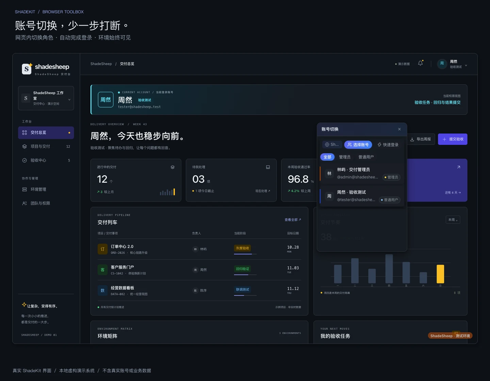
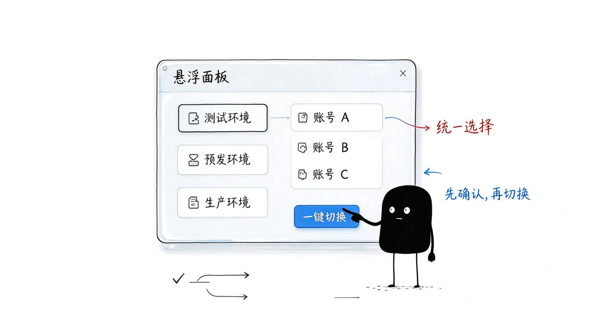
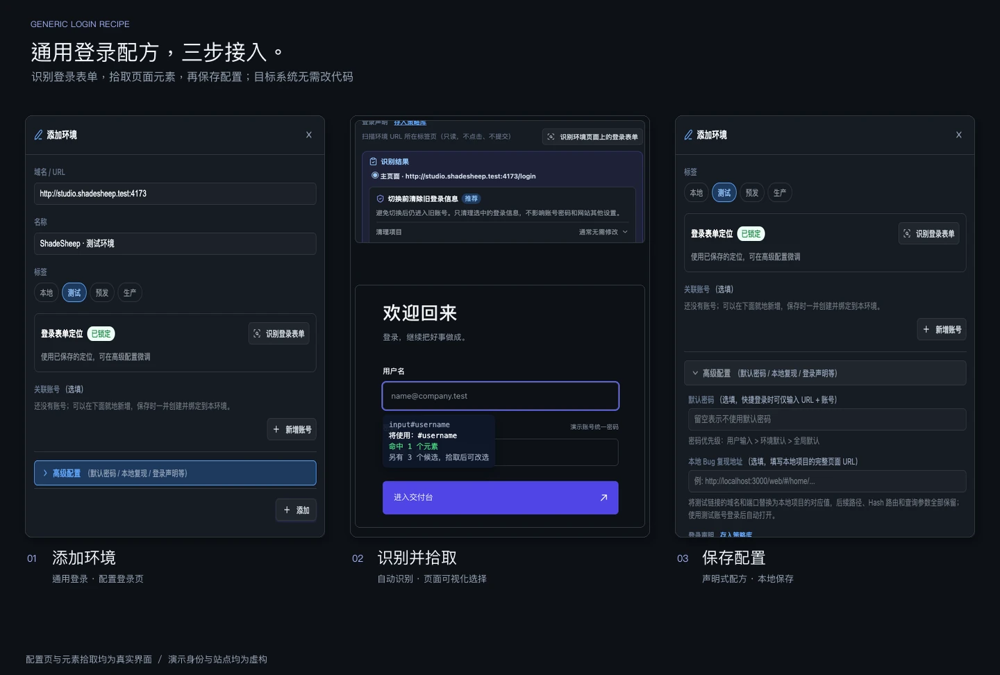
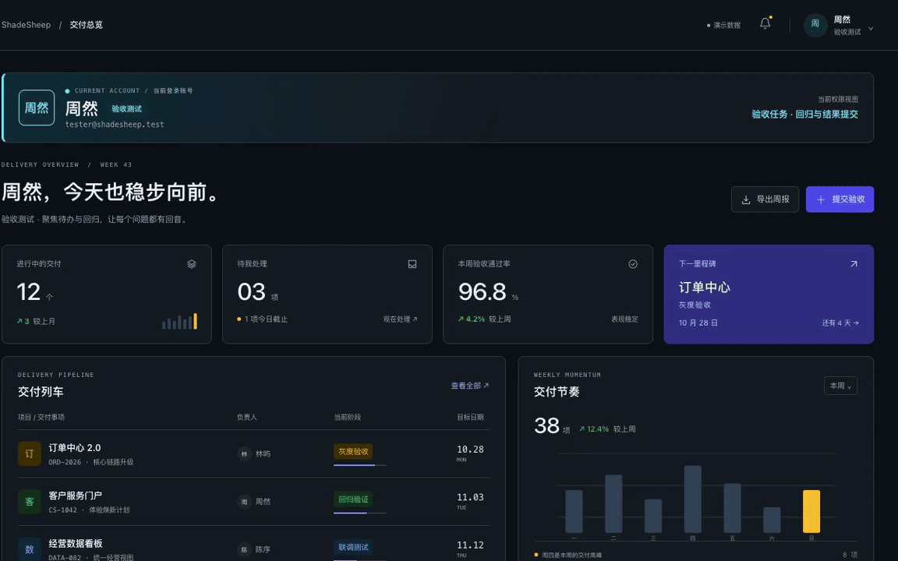
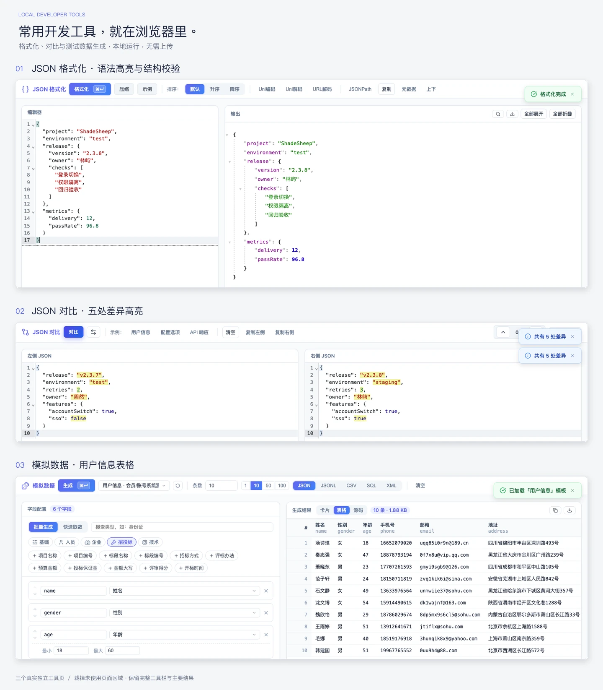
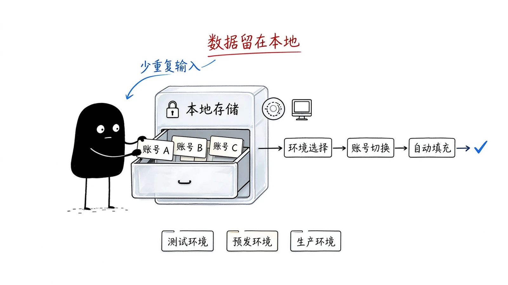

# ShadeKit

[](https://github.com/shadesheep/shadekit/actions/workflows/ci.yml)
[](LICENSE)

面向开发 / 测试 / 实施的浏览器工具箱：**多环境、多账号一键切换** + 常用开发小工具（JSON、代码美化、模拟数据……）。账号配置保存在本机浏览器，JSON 等工具在本地运行，内网离线环境同样可用。



*真实 ShadeKit 界面 + 本机虚构演示系统；账号与业务数据均为示例。*

## 解决什么问题


- **多环境 × 多账号反复登录** — 本地/测试/预发各有 N 个角色账号，每次切换都要手动登出、翻密码、重新登录。ShadeKit 一键完成「登出 → 登录 → 跳转」；通过**通用登录**可以可视化拾取用户名框、密码框和登录按钮，接入常见表单登录系统，无需修改目标系统代码。
- **分不清当前处于哪个环境** — 环境指示器在页面角落常驻半透明标签，避免把生产当测试操作。
- **内部数据不敢贴到在线工具站** — JSON 格式化/对比、代码美化、模拟数据全部在浏览器本地运行，不会把数据发到任何服务器，断网/内网照用。
- **临时造业务测试数据** — 批量生成中文姓名、身份证、手机号、企业、招投标等字段，一键导出 JSON/CSV/SQL。

## 功能一览

| 工具 | 说明 | 打开方式 |
|------|------|----------|
| 环境与账号 | 多环境 × 多账号一键切换，自动完成登出 → 登录 → 跳转；通用登录支持自定义接入常见表单系统 | 悬浮面板 / Popup / `Alt+Shift+A` |
| 环境指示器 | 页面角落常驻半透明标签，标记当前所属环境（本地/测试/生产），四角位置可配置 | 自动注入 |
| JSON 页面格式化 | 浏览器直接打开 JSON 接口地址时，自动渲染为可折叠树 | 自动注入 |
| JSON 格式化 | 格式化、压缩、排序、校验、JSONPath 查询、嵌套转义解析 | 独立标签页 |
| JSON 对比 | 左右对比两个 JSON，RFC 6902 标准差异高亮 | 独立标签页 |
| 图片 Base64 | 图片与 Base64 互转，支持上传/粘贴/拖拽/URL | 独立标签页 |
| 代码美化 | JS/CSS/HTML/XML/SQL 自动美化，支持自动识别格式 | 独立标签页 |
| 模拟数据 | 中文测试数据批量生成（人员/企业/招投标），JSON/CSV/SQL 导出 | 独立标签页 |

## 安装

- [Chrome Web Store](https://chromewebstore.google.com/detail/mpjleclhdlfhdcimphbcbcikklhgkimm)
- [Microsoft Edge Add-ons](https://microsoftedge.microsoft.com/addons/detail/devtools/lgoakbbkpmkpcpmkkcmolgommccofkgn)

也可从源码构建后手动加载（见下文「快速开始」）。

## 快速开始

需要 **Node.js 20 或更新版本**。

### 1. 安装依赖

```bash
npm install
```

### 2. 开发模式

```bash
npm run dev           # Chrome（默认）
npm run dev:firefox   # Firefox
npm run dev:edge      # Edge
```

### 3. 加载到浏览器

开发模式不会自动拉起浏览器，需要手动加载对应产物目录：

| 浏览器 | 开发命令 | 加载方式 |
|--------|----------|----------|
| Chrome | `npm run dev` | `chrome://extensions/` → 开启「开发者模式」→「加载已解压的扩展程序」→ 选择 `.output/chrome-mv3-dev` |
| Edge | `npm run dev:edge` | `edge://extensions/` → 开启「开发人员模式」→「加载解压缩的扩展」→ 选择 `.output/edge-mv3-dev` |
| Firefox | `npm run dev:firefox` | `about:debugging#/runtime/this-firefox` →「临时载入附加组件」→ 选择 `.output/firefox-mv2-dev/manifest.json`；仅用于开发验证，重启浏览器后需重新加载 |

生产构建的 Chrome / Edge 产物分别为 `.output/chrome-mv3` 和 `.output/edge-mv3`，可按同样方式手动加载。

### 4. 构建

```bash
npm run build          # Chrome 版本
npm run build:edge     # Edge 版本
npm run zip:edge       # 打包为 zip
```

> **维护者发布**：`npm run release` 一键构建并提交 Chrome/Edge 双商店，需 `.env` 中的商店发布凭证（字段说明见 `.env.example`，Chrome v2 / Edge 的变量命名差异见 `Makefile` 头部注释）。Chrome 使用 Web Store API v2 的服务账号认证。普通开发、构建和 CI 不读取发布凭证。

## 使用说明

### 环境与账号



*示意图：通过悬浮面板统一选择环境与账号。实际界面与切换过程见下方截图和 GIF。*

#### 首次配置：3 步上手

1. **新建环境并添加账号**：右键插件图标 →「选项」→「环境与账号」→「＋ 环境」，填写环境 URL；在「关联账号」中新增账号，或勾选已有账号，保存环境。同一账号可以关联多个环境。
2. **配置并验证登录方式**：新建环境默认使用「通用登录」。在浏览器中打开该环境的登录页，再进入环境的「编辑 → 高级配置 → 登录声明」，点击「识别环境页面上的登录表单」并回填；识别不到时，用字段旁的拾取按钮选择用户名框、密码框和登录按钮。填写测试凭据，点击「验证配置」，成功后保存环境。
3. **切换账号**：打开目标页面，点击工具栏插件图标，在 Popup 中选择账号；也可以按 `Alt+Shift+A` 唤起悬浮面板，或在选项页账号行的「⋯ → 登录」中操作。



*配置页与元素拾取均为真实界面；截图中的站点和身份均为虚构。试登录默认会发送验证请求，但不写会话、不跳转，也不触达当前标签页。*

快捷键未生效时，打开 `chrome://extensions/shortcuts` 或 `edge://extensions/shortcuts`，为 ShadeKit 的「快速切换账号」设置 `Alt+Shift+A`。



*真实扩展操作的连续录像；演示 Cookie 为临时会话，不含真实业务数据。*

#### 其他接入方式

- **开发者 / AI 辅助接入**：用 AI 生成 Skill 问答式产出完整登录声明（`LoginSpec`），**优先 API 登录**（直接请求登录接口换取 token，更快更稳、不依赖页面跳转），目标系统无可用接口时再使用表单登录。
- **导入现成登录方式**：点击「环境与账号」顶部的「导入登录策略…」，导入 `dt-login-config/v1` 格式的登录策略包，按需同时创建环境。

登录声明的格式与能力边界见[账号切换开发文档](entrypoints/tools/account-switch/README.md)。

#### 备份与团队分享

| 需求 | 入口 | 是否包含账号密码 |
|------|------|------------------|
| 备份或迁移自己的配置 | 选项页顶部「导出全部工具设置 / 导入全部工具设置」 | **是，导出文件包含明文密码**；仅保存到可信位置，不要当作普通配置公开分享 |
| 向同事分享登录方式 | 选中环境 →「⋯ → 导出登录策略包」；接收方点「导入登录策略…」 | 不包含账号绑定和 secret 变量，接收方需自行配置凭据 |

### 环境指示器

在选项页「环境与账号 → 设置 → 环境指示器」中启用，并选择显示位置和范围；未限定环境时，全部已配置环境都会显示半透明角标。也可以在主视图的环境操作中单独开关某个环境的角标。四角位置可配置，默认右下角。

### JSON / 代码工具



点击 Popup 中对应工具，或直接通过选项页「工具总览」打开独立标签页。浏览器直接访问返回 JSON 的接口地址时，会自动格式化为可折叠树（可在「JSON 格式化」配置中关闭）。

## 本地数据与隐私



账号与环境配置保存在本机浏览器的 `chrome.storage.local`；JSON 格式化/对比、代码美化、模拟数据等工具在浏览器本地处理数据，不向 ShadeKit 服务器上传，内网离线环境同样可用。账号登录会按登录声明访问目标系统，使用图片 URL 导入等功能时也会发起相应网络请求。

「本地运行」不代表数据永不离开浏览器：你主动导出的配置、复制的凭据，以及发送给目标系统的登录请求，会按对应操作离开本地存储。完整配置导出文件包含明文账号密码，请像保管密码一样保管它。

> 本地存储不等于加密保险箱。本工具面向开发/测试环境，请勿用于管理生产环境真实账号；不支持需要短信验证码、扫码等双因素认证的账号。

## 技术栈

- **WXT** (Web Extension Toolkit) — 基于 Vite 的扩展框架
- **Vue 3** — Composition API + `<script setup>`
- **UnoCSS** — 原子化 CSS（Preset Uno + Lucide 图标）
- **Pinia** — 状态管理
- **CodeMirror 6** — JSON 编辑器
- **fast-json-patch** — RFC 6902 JSON Patch
- **js-beautify** — 代码美化
- **jsencrypt** — RSA 加密
- **TypeScript** — strict 模式

## 项目结构

```
entrypoints/
├── background.ts                  # 扩展后台（消息路由、右键菜单、快捷键）
├── content/                       # Content Script（悬浮面板、Toast、环境指示器，暗色不影响宿主页面）
├── json-page-format.content/      # JSON 页面自动格式化（Content Script）
├── popup/                         # 扩展图标弹出面板
├── options/                       # 选项页（工具总览 + 各工具配置）
├── shared/                        # 共享模块
│   ├── types.ts                   # 类型定义
│   ├── tool-definitions.ts        # 工具注册表
│   ├── tool-config.ts             # 配置读写
│   ├── tool-state.ts              # 启用/禁用状态
│   ├── use-theme.ts               # 主题管理
│   └── use-toast.ts               # Toast 通知
└── tools/
    ├── account-switch/            # 环境与账号（含环境指示器）
    ├── json-formatter/            # JSON 格式化
    ├── json-diff/                 # JSON 对比
    ├── image-base64/              # 图片 Base64
    ├── code-beautify/             # 代码美化
    └── mock-data/                 # 模拟数据
```

## 添加工具

1. 在 `entrypoints/tools/{tool-id}/` 中创建 `Config.vue` 和可选的 `Popup.vue`
2. 如需独立标签页，创建 `entrypoints/{tool-id}/` 目录，包含 `main.ts`、`App.vue`、`index.html`
3. 在 `entrypoints/shared/tool-definitions.ts` 中注册工具

## 存储约定

| Key | 用途 | 模块 |
|-----|------|------|
| `devtools-{toolId}` | 各工具配置 | `tool-config.ts` |
| `devtools-state` | 工具启用/禁用状态 | `tool-state.ts` |
| `devtools-theme` | 主题偏好（system/light/dark） | `use-theme.ts` |

## 快捷键

| 快捷键 | 功能 |
|--------|------|
| `Alt+Shift+A` | 快速打开账号切换面板（建议值，被占用时需在浏览器快捷键设置中重新指定） |

## 贡献

提交 PR 前请运行：`npm run check`（类型检查）、`npm run lint`（代码检查）、`npm test`（单元测试）和 `npm run build`（构建），与 CI 保持一致。演示服务可另外运行 `npm run test:demo`；配图复现见[演示系统与素材制作](docs/readme-demo/README.md)。

欢迎 Issue 与 PR，请先阅读[贡献指南](CONTRIBUTING.md)。架构决策记录见 [docs/adr/](docs/adr/)，领域术语表见 [CONTEXT.md](CONTEXT.md)，版本变更见 [CHANGELOG.md](CHANGELOG.md)。

## 安全

安全漏洞请勿公开开 Issue，走 [SECURITY.md](SECURITY.md) 的私密渠道。

## License

[MIT](LICENSE)
